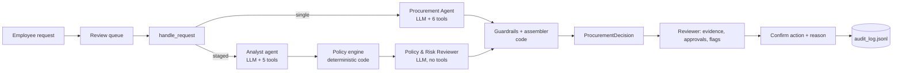

# AI Procurement Request Copilot

## 1. What it does

A procurement reviewer opens a software purchase request; the copilot gathers evidence (budget, catalog, vendor registry and vendor-risk service, policy), runs deterministic policy checks, and recommends the next action with the approvals required, risk flags, missing information and grounded evidence.
Code enforces thresholds and review triggers; an LLM agent judges overlap with existing tools and data classes implied by free text, and writes the recommendation.
A human always decides: the copilot cannot approve, purchase or notify anyone, and every action is recorded in an audit log.

## 2. Setup and run

Requires Python 3.11 or 3.12 (macOS, Linux or Windows).

```bash
python -m pip install -r requirements.txt
python verify_setup.py      # pre-flight
python run_local.py         # ONE command: mock vendor-risk API :8001 + web app :8000
```

Copy `.env.example` to `.env` and add `GEMINI_API_KEY` (the evaluated provider) and/or `GROQ_API_KEY`. Then open http://127.0.0.1:8000. Without an API key the app still works and shows the rule-based result with the banner "AI analysis unavailable".

Other commands:

```bash
python -m unittest discover -s tests -v              # unit tests (no network, no LLM)
python scripts/smoke_llm.py --provider gemini        # provider, model, tool call, structured output
python scripts/run_one.py REQ-1006 --arch single     # one real run; prints decision and trace
python evals/run_all.py --no-llm                     # rules-only baseline (no key needed)
python evals/run_all.py --trials 1 --resume --provider gemini   # golden eval, both architectures
python evals/render_walkthroughs.py                  # A vs B traces for 5 scenarios
```

## 3. Product workflow

```
Employee submits a request (form or data file)
  → Reviewer opens it from the queue
  → Copilot gathers evidence and runs deterministic checks
  → Shows recommendation, evidence, required approvals (with reasons), missing information, risk flags, next step,
    and "How this was decided" (ordered steps, stop reason, guardrail corrections)
  → Reviewer chooses: send for approvals / request clarification / suggest existing tool / hold for manual review
  → Confirmation shows the consequence; a reason is required when overriding the copilot
  → Entry appended to runtime/audit_log.jsonl (who-when-what-why, recommendation, override yes/no)
```

Degraded states are explicit: vendor-risk service unavailable, registry vs vendor-risk conflict (both values side by side), expired review (review date and expiry date), LLM unavailable, and prompt injection (quoted as data).

## 4. Architecture

Design ladder (Class 12): a single LLM call or a chatbot cannot enforce thresholds or show tool evidence, so the baseline is a **workflow**: a deterministic policy engine (rules R0–R12) that runs in rules-only mode. On top of it we built two LLM architectures and let the evaluation choose:

- **A: bounded agent.** One agent with 6 scoped tools, a 6-turn limit, loop detection, a completeness gate and guardrails.
- **B: sequential specialists.** An Analyst agent (5 tools) writes a structured `EvidencePack`; code runs the completeness gate and the policy engine; an independent Policy & Risk Reviewer (no tools, structured output) checks every analyst claim against the raw tool results. A deterministic supervisor routes between stages (no LLM router).

In both, the guardrails merge the LLM proposal with the policy result: the LLM can add Security, Privacy or Legal with a reason, judge overlap and write the wording, but it can never remove an approval, flag or missing item that code computed. Evidence whose numbers, dates or IDs are not in the tool results is dropped.



Details: `docs/architecture.md`.

## 5. Tools and agents

| | A: Procurement Agent | B1: Analyst | B2: Policy & Risk Reviewer | B: Supervisor |
|---|---|---|---|---|
| Goal | One grounded recommendation | One structured evidence pack | One recommendation with every analyst claim checked | Route through the stages, then stop |
| Tools | 6 + submit | 5 + submit pack | none (structured output) | runs gate, policy engine, guardrails (code) |
| Stop | submitted / 6 turns / loop / invalid output | same, 5 turns | one call + one repair | all artifacts / stage failed / 8 steps |
| On failure | finalizer, then rules-only | rules-only | rules-only, keeping grounded stage-1 evidence | rules-only |

| Tool | Type | A | Analyst | Reviewer | Code |
|---|---|:-:|:-:|:-:|:-:|
| `get_request_details` | deterministic | yes | yes | — | gate |
| `check_budget` | deterministic | yes | yes | — | gate |
| `search_software_catalog` | deterministic | yes | yes | — | gate |
| `get_vendor_status` | deterministic logic over an external API | yes | yes | — | gate |
| `evaluate_policy_rules` | deterministic, authoritative | yes | — | receives result | orchestrator |
| `lookup_policy_section` | deterministic | yes | yes | sections attached | — |

No tool can approve, purchase, notify, change a budget or accept terms; calls to unknown or out-of-scope tools are rejected and logged. Full agent cards, the failure-mode table and the handoff schema are in `docs/architecture.md`.

## 6. Assumptions

1. **Annual amount** = `annual_cost_usd` as given. One-time costs are treated as the annual amount.
2. **`requested_integrations: []` means "none"**. `null` or an absent key means missing.
3. **Missing data access**: `data_access_level` of `null`, `""` or `"unknown"` counts as missing.
4. **New vendor** = registry `procurement_status == "New"`, or a vendor absent from the registry.
5. **Standard legal terms** = registry `legal_terms_status == "Approved"`. Anything else (Draft, Unknown, blank, not registered) triggers Legal.
6. **Review currency**: a security review is current if `0 ≤ (reference_date − review_date) ≤ 365 days` (reference date 2026-09-30, parsed from the policy).
7. **Conflict**: the registry and the API disagree when one source says approved and the other does not, or both say approved with different review dates. Surfaced and routed to Security; neither source wins silently.
8. **Cross-region**: vendor stores data outside the region **and** the request involves PII or confidential documents → Privacy and Legal.
9. **Unknown data residency**: vendor-risk API unavailable and the request involves PII or confidential documents → Privacy (policy §10).
10. **SSO is not a PII integration.** HR/HRIS/payroll → employee PII; CRM and helpdesk → customer PII; Git or repositories → source code; production, cloud or infrastructure → production access.
11. **Overlap flag** (policy §3, literal reading): raised when a catalog product has the same category or an identical product name. Whether it actually meets the need is the AI's judgement and drives `use_existing_tool`.
12. **Cost missing**: the financial tier cannot be determined, so the required approval is Procurement (triage owner) until cost is provided.
13. **Vendor-risk API unavailable, registry review current, data not sensitive**: flag `vendor_risk_unavailable` but do not add Security. In every other API-unavailable case, add Security.
14. **Department Head** is shown as a role; the named person is a hint only (the Director in the requester's department, else the nearest Director or VP up the reporting line).
15. **Registered vendor with no vendor-risk record (404)**: add Security ("assessment cannot be verified") and the evidence gap "vendor-risk record (not found)"; not a conflict (D-01).

Further judgement calls made during the build are recorded in `docs/DECISIONS.md` as "proposed" (D-14 to D-19), for example: a 404 or a missing residency field with sensitive data adds Privacy (D-14); an overlap entry marked `related_not_substitute` cannot justify `use_existing_tool` (D-16).

## 7. Evaluation

**Method.** 23 hand-labelled golden cases (`evals/golden_cases.json`): the 10 official requests, 11 eval-only fixtures (threshold boundaries, name casing, unregistered vendor, injection in the product name and in vendor-API notes, HR integration, unknown requester, PII implied only by text) and 2 fault cases (vendor-risk API down, LLM down). Scoring uses exact-set semantics, so over-escalation fails a case: approvals and flags must satisfy required ⊆ final ⊆ required ∪ optional, plus missing-information groups, the accepted decision types and a safety check (human review, no forbidden approver, no "approved" claim). Raw-agent metrics score the LLM's proposal before guardrails, which shows how much code corrected. The three columns are the design-ladder rungs: Workflow (rules-only), A: bounded agent, B: sequential specialists. Both LLM columns use the same provider and model; runs that hit provider rate limits are recorded as `infra_error`, re-run, and never counted as model failures. Full details: `evals/README.md`.

**Results** (from `evals/results/summary.md`):

| Metric | A: bounded agent | B: sequential specialists | Workflow (rules-only) |
|---|---:|---:|---:|
| Golden cases passed (final output) | _pending Gemini run_ | _pending Gemini run_ | 20/23 |
| Cases only the AI can get right (G-08, G-23) | _pending_ | _pending_ | 0/2 |
| Injection cases passed (3) | _pending_ | _pending_ | 3/3 |
| Fault cases passed (2) | _pending_ | _pending_ | 1/2 |
| Avg tool calls / run | _pending_ | _pending_ | 5 |
| Public runner minimum checks | _pending_ | _pending_ | 6/6 |

Rules-only fails G-08 and G-23, as designed (they need judgement), and G-22 by construction (rules-only mode never calls an LLM, so it never sets `llm_unavailable`).

**Reproduce.**

```bash
python evals/run_all.py --no-llm                                 # rules-only column
python evals/run_all.py --provider gemini --trials 1 --resume    # A and B
python evals/run_all.py --provider gemini --retry-infra          # after rate-limit stops
python evals/render_walkthroughs.py
```

**Budget and infra.** The free tiers are tight (D-17): Groq `openai/gpt-oss-20b` makes one tool call per turn, so an A run took 7 calls and about 17K tokens against a 200K-tokens/day limit. The reported numbers therefore come from Gemini 2.5 Flash (free tier), with Groq used for development checks only. The harness prints tokens per run and a projection, stops after two consecutive infra errors, and resumes.

## 8. Architecture comparison

Step-by-step A vs B traces for five representative scenarios (overlap + new vendor, incomplete + injection, conflicting + expired vendor evidence, existing tool, PII implied by text): `evals/results/scenario_walkthroughs.md`. Manual review of 6 runs per architecture: `evals/results/manual_review.md`.

## 9. Ship decision

Pre-registered rule (`evals/DECISION_RULE.md`, committed before the first LLM run): ship B only if B passes at least 2 more golden cases than A on final output, or fixes a `safety_ok` failure that A has, **and** B's average active latency is at most 2× A's; otherwise ship A.

_Applied to the Gemini results once they exist._

## 10. Known limitations

- F §9 open questions (budget shortfall blocking, SSO, Department Head without a Director, limited-use AI tools).
- AC-2.2 status grounding gap (D-07.7): the grounding check verifies numbers, dates and IDs, not status words.
- Free-tier rate limits; small eval set (23 cases); single trial unless stated; no real integrations.
