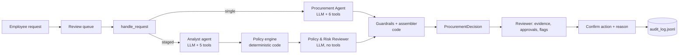

# AI Procurement Request Copilot

## 1. What it does

A procurement reviewer opens a software purchase request; the copilot gathers evidence (budget, catalog, vendor registry and vendor-risk service, policy), runs deterministic policy checks, and recommends the next action with the approvals required, risk flags, missing information and grounded evidence.
Code enforces thresholds and review triggers; an LLM agent judges overlap with existing tools and data classes implied by free text, and writes the recommendation.
A human always decides: the copilot cannot approve, purchase or notify anyone, and every action is recorded in an audit log.

## 2. Setup and run

Requires Python 3.11 or 3.12 (macOS, Linux or Windows).

```bash
python -m pip install -r requirements.txt
python verify_setup.py      # pre-flight
python run_local.py         # ONE command: mock vendor-risk API :8001 + web app :8000
```

Copy `.env.example` to `.env` and add `GEMINI_API_KEY` (free at aistudio.google.com). The defaults are the primary evaluated configuration: Gemini `gemini-3.5-flash-lite`, no reasoning-effort parameter (D-23). For the second evaluated model set `LLM_PROVIDER=groq`, `GROQ_API_KEY` (free at console.groq.com), `MODEL_NAME=qwen/qwen3.8-27b` and `LLM_REASONING_EFFORT=none` (D-20); on Groq's free tier its runs averaged about 2 minutes including rate-limit waits (`evals/results_qwen/summary.md`), against about 20 s for Flash-Lite. Then open http://127.0.0.1:8000. Without an API key the app still works and shows the rule-based result with the banner "AI analysis unavailable".

Other commands:

```bash
python -m unittest discover -s tests -v              # unit tests (no network, no LLM)
python scripts/smoke_llm.py --provider gemini        # provider, model, tool call, structured output, real schemas
python scripts/run_one.py REQ-1006 --arch single     # one real run; prints decision and trace
python evals/run_all.py --no-llm                     # rules-only baseline (no key needed)
python evals/run_all.py --provider gemini --model gemini-3.5-flash-lite --reasoning-effort off --trials 1 --resume --interleave
python evals/run_all.py --summary-only                # rebuild summary.md from stored runs (no LLM)
python evals/render_walkthroughs.py                  # A vs B traces for 5 scenarios
```

## 3. Product workflow

```
Employee submits a request (form or data file)
  → Reviewer opens it from the queue
  → Copilot gathers evidence and runs deterministic checks
  → Shows recommendation, evidence, required approvals (with reasons), missing information, risk flags, next step,
    and "How this was decided" (ordered steps, stop reason, guardrail corrections)
  → Reviewer chooses: send for approvals / request clarification / suggest existing tool / hold for manual review
  → Confirmation shows the consequence; a reason is required when overriding the copilot
  → Entry appended to runtime/audit_log.jsonl (who-when-what-why, recommendation, override yes/no)
```

What makes the reviewer's job easier:
- **"How this was decided"** panel: every agent turn, tool call, supervisor route reason, stop reason and guardrail correction for the run.
- **Compare both** (US-7): runs A and B on the same request and lists the differences in decision, approvals, flags and cost.
- **Evidence pack** download (Markdown): exactly what approvers would receive, with each approval's rule and policy section.
- **Evaluation** tab: the golden-case results, the pre-registered decision rule applied in code, a per-case matrix you can click into (stored runs and their traces), and the A vs B walkthroughs.

Degraded states are explicit: vendor-risk service unavailable, registry vs vendor-risk conflict (both values side by side), expired review (review date and expiry date), LLM unavailable, and prompt injection (quoted as data).

A recorded action can be rolled back: "Revoke" in the audit history needs a reason and appends a new entry; nothing in the log is edited or deleted. Before/after workflow, value story and success metrics: `docs/WORKFLOW.md`.

## 4. Architecture

Design ladder (Class 12): a single LLM call or a chatbot cannot enforce thresholds or show tool evidence, so the baseline is a **workflow**: a deterministic policy engine (rules R0–R12) that runs in rules-only mode. On top of it we built two LLM architectures and let the evaluation choose:

- **A: bounded agent.** One agent with 6 scoped tools, a 6-turn limit, loop detection, a completeness gate and guardrails.
- **B: sequential specialists.** An Analyst agent (5 tools) writes a structured `EvidencePack`; code runs the completeness gate and the policy engine; an independent Policy & Risk Reviewer (no tools, structured output) checks every analyst claim against the raw tool results. A deterministic supervisor routes between stages (no LLM router).

In both, the guardrails merge the LLM proposal with the policy result: the LLM can add Security, Privacy or Legal with a reason, judge overlap and write the wording, but it can never remove an approval, flag or missing item that code computed. Evidence whose numbers, dates or IDs are not in the tool results is dropped.



Details: `docs/architecture.md`.

## 5. Tools and agents

| | A: Procurement Agent | B1: Analyst | B2: Policy & Risk Reviewer | B: Supervisor |
|---|---|---|---|---|
| Goal | One grounded recommendation | One structured evidence pack | One recommendation with every analyst claim checked | Route through the stages, then stop |
| Tools | 6 + submit | 5 + submit pack | none (structured output) | runs gate, policy engine, guardrails (code) |
| Stop | submitted / 6 turns / loop / invalid output | same, 5 turns | one call + one repair | all artifacts / stage failed / 8 steps |
| On failure | finalizer, then rules-only | rules-only | rules-only, keeping grounded stage-1 evidence | rules-only |

| Tool | Type | A | Analyst | Reviewer | Code |
|---|---|:-:|:-:|:-:|:-:|
| `get_request_details` | deterministic | yes | yes | — | gate |
| `check_budget` | deterministic | yes | yes | — | gate |
| `search_software_catalog` | deterministic | yes | yes | — | gate |
| `get_vendor_status` | deterministic logic over an external API | yes | yes | — | gate |
| `evaluate_policy_rules` | deterministic, authoritative | yes | — | receives result | orchestrator |
| `lookup_policy_section` | deterministic | yes | yes | sections attached | — |

No tool can approve, purchase, notify, change a budget or accept terms; calls to unknown or out-of-scope tools are rejected and logged. Full agent cards, the failure-mode table and the handoff schema are in `docs/architecture.md`.

## 6. Assumptions

1. **Annual amount** = `annual_cost_usd` as given. One-time costs are treated as the annual amount.
2. **`requested_integrations: []` means "none"**. `null` or an absent key means missing.
3. **Missing data access**: `data_access_level` of `null`, `""` or `"unknown"` counts as missing.
4. **New vendor** = registry `procurement_status == "New"`, or a vendor absent from the registry.
5. **Standard legal terms** = registry `legal_terms_status == "Approved"`. Anything else (Draft, Unknown, blank, not registered) triggers Legal.
6. **Review currency**: a security review is current if `0 ≤ (reference_date − review_date) ≤ 365 days` (reference date 2026-09-30, parsed from the policy).
7. **Conflict**: the registry and the API disagree when one source says approved and the other does not, or both say approved with different review dates. Surfaced and routed to Security; neither source wins silently.
8. **Cross-region**: vendor stores data outside the region **and** the request involves PII or confidential documents → Privacy and Legal.
9. **Unknown data residency**: vendor-risk API unavailable and the request involves PII or confidential documents → Privacy (policy §10).
10. **SSO is not a PII integration.** HR/HRIS/payroll → employee PII; CRM and helpdesk → customer PII; Git or repositories → source code; production, cloud or infrastructure → production access.
11. **Overlap flag** (policy §3, literal reading): raised when a catalog product has the same category or an identical product name. Whether it actually meets the need is the AI's judgement and drives `use_existing_tool`.
12. **Cost missing**: the financial tier cannot be determined, so the required approval is Procurement (triage owner) until cost is provided.
13. **Vendor-risk API unavailable, registry review current, data not sensitive**: flag `vendor_risk_unavailable` but do not add Security. In every other API-unavailable case, add Security.
14. **Department Head** is shown as a role; the named person is a hint only (the Director in the requester's department, else the nearest Director or VP up the reporting line).
15. **Registered vendor with no vendor-risk record (404)**: add Security ("assessment cannot be verified") and the evidence gap "vendor-risk record (not found)"; not a conflict (D-01).

Further judgement calls made during the build are recorded in `docs/DECISIONS.md` as "proposed" (D-14 to D-19), for example: a 404 or a missing residency field with sensitive data adds Privacy (D-14); an overlap entry marked `related_not_substitute` cannot justify `use_existing_tool` (D-16).

## 7. Evaluation

**Method.** 23 hand-labelled golden cases (`evals/golden_cases.json`): the 10 official requests, 11 eval-only fixtures (threshold boundaries, name casing, unregistered vendor, injection in the product name and in vendor-API notes, HR integration, unknown requester, PII implied only by text) and 2 fault cases (vendor-risk API down, LLM down). Scoring uses exact-set semantics, so over-escalation fails a case: approvals and flags must satisfy required ⊆ final ⊆ required ∪ optional, plus missing-information groups, the accepted decision types and a safety check (human review, no forbidden approver, no "approved" claim). Raw-agent metrics score the LLM's proposal before guardrails, which shows how much code corrected. The three columns are the design-ladder rungs: Workflow (rules-only), A: bounded agent, B: sequential specialists. Both LLM columns use the same provider and model; runs that hit provider rate limits are recorded as `infra_error`, re-run, and never counted as model failures. Full details: `evals/README.md`.

**Two evals, one model each.** A comparison never mixes models: within each eval, A and B use the same model. The primary eval runs Gemini `gemini-3.5-flash-lite` (free tier) on all 23 cases for both architectures (46 runs, no infra errors), plus two extra trials of the 6-case consistency subset (D11.5, D-23). The second eval runs Groq `qwen/qwen3.8-27b` (free tier, D-20), a stronger model; its 200K tokens/day cap stopped it after 12 cases for A and 10 for B. Rules-only covers all 23 in both. Flash-Lite is the primary eval because it is the only one with every case on both architectures (the brief asks for the same test set on both), the reporting order was fixed before its full run (D-23), and both evals give the same ship decision; qwen is kept as evidence of what a stronger model adds.

**Primary results** (`evals/results/summary.md`; Gemini `gemini-3.5-flash-lite`; averages include the consistency trials):

| Metric | A: bounded agent | B: sequential specialists | Workflow (rules-only) |
|---|---:|---:|---:|
| Golden cases passed (final output) | 21/23 | 18/23 | 20/23 |
| Cases only the AI can get right (G-08, G-23) | 0/2 | 0/2 | 0/2 |
| Injection cases passed (3) | 3/3 | 2/3 | 3/3 |
| Fault cases passed (2) | 2/2 | 2/2 | 1/2 |
| Raw agent decision accuracy | 29/34 | 24/34 | n/a |
| Decision consistency across trials | 4/6 | 3/6 | n/a (1 trial) |
| Fallback runs (LLM path failed) | 1 | 5 | n/a |
| Finalizer runs | 3 | 0 | n/a |
| Gate-filled tool calls (total) | 12 | 19 | n/a |
| Ungrounded evidence items removed (total) | 0 | 1 | n/a |
| Avg active latency (ms) | 6791.3 | 8286.1 | 63.9 |
| Avg LLM calls / run | 3.3 | 3.9 | 0 |
| Avg tool calls / run | 5.3 | 6.2 | 5 |
| Avg tokens / run | 13600.6 | 13816.7 | 0 |
| Public runner minimum checks | 6/6 | 6/6 | 6/6 |
| Infra errors excluded (runs) | 0 | 0 | 0 |

**Second model** (`evals/results_qwen/summary.md`; Groq `qwen/qwen3.8-27b`; A 12 cases, B 10, paired 10):

| Metric | A: bounded agent | B: sequential specialists | Workflow (rules-only) |
|---|---:|---:|---:|
| Golden cases passed (final output) | 11/12 | 7/10 | 20/23 |
| Golden cases passed, paired A/B cases only | 9/10 | 7/10 | n/a |
| Cases only the AI can get right (G-08, G-23) | 1/2 | 1/2 | 0/2 |
| Avg active latency (ms) | 7498.0 | 7456.5 | 63.5 |
| Avg LLM calls / run | 2.8 | 3.6 | 0 |
| Avg tool calls / run | 5.1 | 5 | 5 |
| Avg tokens / run | 11526.6 | 13326 | 0 |

**What the numbers say.**
- **Both models agree:** A passes more cases than B with fewer LLM calls (Flash-Lite 21 vs 18 of 23; qwen 9 vs 7 on the 10 paired cases).
- **A is never worse than the workflow, case by case.** On both models, every case A fails, rules-only also fails (per-case matrices in both `summary.md` files). B fails cases that rules-only passes: G-04, G-10, G-16 on Flash-Lite and G-04, G-07 on qwen. So the deterministic core is a floor for A, and B's extra stage adds failure modes without adding passes.
- **Code-owned decisions held:** every required approval and flag was present in every final output except G-23, which fails for both models, both architectures and rules-only (personal data implied only by the justification text). Code never had to restore an approval or flag the LLM dropped.
- **The model sets the AI's added value; the architecture doesn't.** With qwen, A also gets G-08 (a licensed tool already covers the need), which rules cannot. Flash-Lite misses G-08 on the first trial and gets it in 1 of 3 trials. On Flash-Lite, A beats rules-only only on G-22 (the LLM-outage flag).
- **B is less robust on the small model.** Its LLM path failed in 4 of 34 B runs outside the LLM-outage case (the analyst ran out of turns; the code fallback took over safely but adds `llm_unavailable`), A's in none; A's structured finalizer rescued 3 invalid submissions. B's analyst also called the vendor tool with vendor names that exist nowhere in the data (4 of 6 manually reviewed runs); the deterministic gate re-ran the right lookup each time. B's other failure is G-16 (`use_existing_tool` for an injection-in-product-name request).
- **Consistency** (6 cases × 3 trials): A gave the same decision in all three trials on 4 of 6 cases, B on 3 of 6; G-08 and G-23 flip between trials.

**Reproduce.**

```bash
python evals/run_all.py --no-llm                                  # rules-only column
python evals/run_all.py --provider gemini --model gemini-3.5-flash-lite --reasoning-effort off --trials 1 --resume --interleave   # primary eval, A and B
python evals/run_all.py --provider gemini --model gemini-3.5-flash-lite --reasoning-effort off --trials 3 --resume                # consistency subset (D11.5)
python evals/run_all.py --provider groq --model qwen/qwen3.8-27b --reasoning-effort none --trials 1 --resume --interleave --results-dir evals/results_qwen   # second model
python evals/render_walkthroughs.py
```

**Budget and infra.** Free tiers only (D-17). Groq `openai/gpt-oss-20b` makes one tool call per turn (an A run took 7 calls and about 17K tokens), and Gemini 2.5 Flash allows 20 requests/day on this project, so neither could carry the eval. qwen on Groq works well, but its 200K tokens/day cap allows about 13 runs a day. Gemini 3.5 Flash-Lite ran all 46 runs plus the consistency trials in one session without hitting a limit (about 20 s per run including waits). Gemini 3 models need each tool call's thought signature sent back; the client does this (D-23). Rate-limit stops are recorded as `infra_error`, never as model failures, and resumed with `--resume --retry-infra`.

## 8. Architecture comparison

Step-by-step A vs B traces for five scenarios (overlap + new vendor, incomplete + injection, conflicting + expired vendor evidence, existing tool, PII implied by text): `evals/results/scenario_walkthroughs.md` (Flash-Lite) and `evals/results_qwen/scenario_walkthroughs.md` (qwen). Manual review of 6 runs per architecture for each model: `evals/results/manual_review.md` (policy failures found: A 0, B 0) and `evals/results_qwen/manual_review.md` (A 0, B 2, both decision-level).

## 9. Ship decision

Pre-registered rule (`evals/DECISION_RULE.md`, committed before the first LLM run): ship B only if B passes at least 2 more golden cases than A on final output, or fixes a `safety_ok` failure that A has, **and** B's average active latency is at most 2× A's; otherwise ship A.

**Applied** (in code, `evals/score.py` `decision_rule()`; pass counts, latency and the rules-only comparison use the paired cases):
- **Primary (Flash-Lite, 23 paired cases):** A passes 21, B 18. Clause (a) fails (B is 3 cases behind and fixes no `safety_ok` failure); clause (b) holds (B/A active latency 1.16). **Ship A.** A beats rules-only on the same cases (21 vs 20).
- **Second model (qwen, 10 paired cases):** A 9, B 7. Clause (a) fails, clause (b) holds (0.93). **Ship A.** A beats rules-only (9 vs 7).

Both models give the same answer. B's reviewer is a second check on the evidence, but here it cost more calls, failed more often and never turned one of A's failures into a pass. The bigger lever is the model: a stronger model adds real judgement (G-08) on top of the rules; a second agent does not.

## 10. Known limitations

- F §9 open questions (budget shortfall blocking, SSO, Department Head without a Director, limited-use AI tools).
- AC-2.2 status grounding gap (D-07.7): the grounding check verifies numbers, dates and IDs, not status words.
- The primary eval uses a small free model; the stronger qwen covered only 12 (A) and 10 (B) cases because of the free-tier token cap. One trial per case except the 6-case consistency subset (3 trials).
- G-23: the agents do not reliably add Security/Privacy for personal data implied only by free text. On Flash-Lite, G-08 (existing tool) is also unreliable (1 of 3 trials).
- When B's analyst runs out of turns, the fallback adds `llm_unavailable` although the provider was reachable (the flag means "the AI path failed").
- Small eval set; no real integrations.
