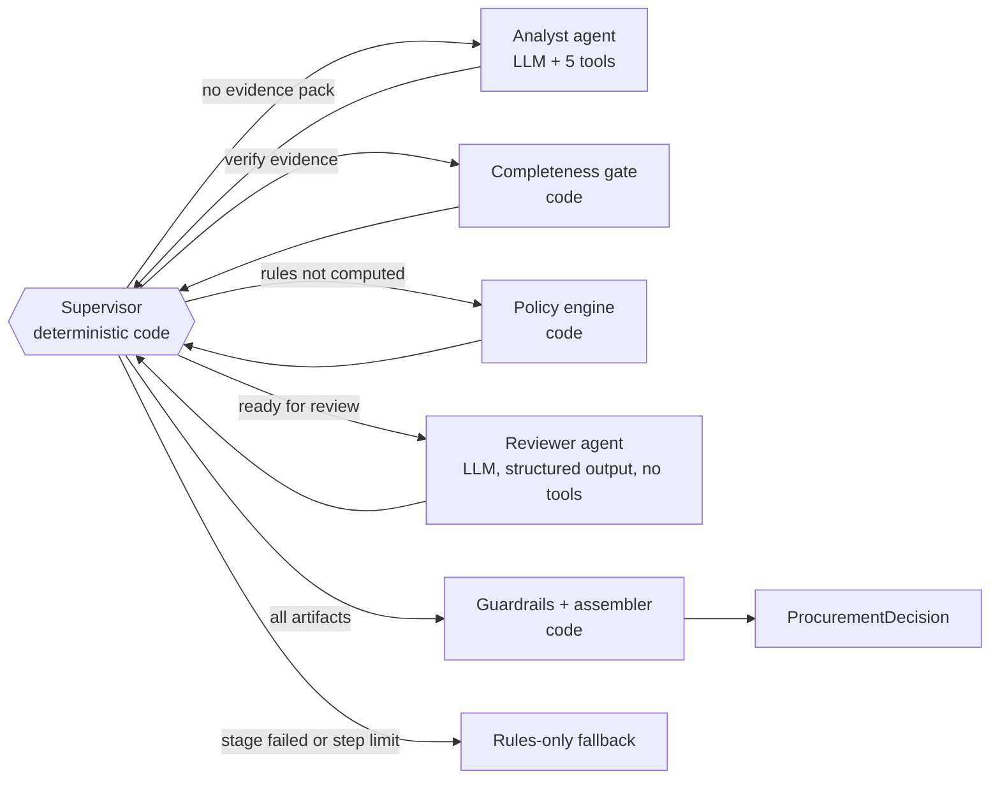

# SPEC_V2_DELTA.md: Changes for Classes 12–13 (authoritative)

**Precedence:** where this file and `SPEC_TECHNICAL.md` differ, **this file wins**. Business rules (R0–R12) and golden labels are unchanged. The policy file remains the source of truth for rules.

Why this exists: the original spec predates Class 12 (AI agents) and Class 13 (multi-agent workflows + evaluation), and two provider facts changed (checked 9 Oct 2026). `SPEC_TECHNICAL.md` T0 maps every lecture concept to a section; this file holds the details.

---

## D1. Provider and model defaults (replaces the T7 provider table)

| Provider | base_url | Key env | Default model | Alternative | Default min interval |
|---|---|---|---|---|---|
| groq (default) | `https://api.groq.com/openai/v1` | `GROQ_API_KEY` | `openai/gpt-oss-20b` | `openai/gpt-oss-120b` | 2.5 s |
| gemini | `https://generativelanguage.googleapis.com/v1beta/openai/` | `GEMINI_API_KEY` (fallback `GOOGLE_API_KEY`) | `gemini-2.5-flash` | — | 6 s |

- **Do not use `llama-3.3-70b-versatile`**: Groq lists it as Enterprise-only now. Gemini 3.x previews are paid-only. `openai/gpt-oss-20b` is the model used in the Class 12/13 notebooks.
- Create the SDK client with `OpenAI(base_url=..., api_key=..., max_retries=0, timeout=LLM_TIMEOUT_SECONDS)`. Our own retry loop owns retries so waits are counted (T7).
- Send `reasoning_effort` only when `LLM_REASONING_EFFORT` is set. If the provider rejects the parameter (HTTP 400 naming it), drop it for the rest of the process and log one warning.
- Any reported comparison uses the **same provider and model for both architectures**.
- The "Forcing the final tool" bullet in T7 is **removed**. Forced `tool_choice` is never used; D2's finalizer replaces it.

## D2. Structured outputs (extends T7)

Class 12/13 lesson: on Groq, schema-constrained output through tool calls can fail with `400 tool_use_failed`; the notebooks switched to JSON-schema structured outputs. Groq does not allow tools and structured outputs in the same request.

1. `src/structured.py::strict_schema(model_cls) -> dict`. From `model_cls.model_json_schema()`, recursively: every object gets `"additionalProperties": false` and `"required"` = all its property names; nullable fields stay `anyOf [..., {"type":"null"}]`; remove `default` keys; keep `$defs`/`$ref`. Unit-tested.
2. `LLMClient.chat_structured(messages, schema_model, name) -> (parsed, ChatResult)`. Sends `response_format={"type":"json_schema","json_schema":{"name":name,"strict":S,"schema":strict_schema(...)}}` and **no `tools`**. `S = True` only for Groq `openai/gpt-oss-*`; otherwise `False`. Parse with `schema_model.model_validate_json`. On a validation error, make one repair call (append the pydantic errors), else raise `InvalidOutput`.
3. Tool loops may still finish by the model calling `submit_recommendation` / `submit_evidence_pack` as a tool (validated with pydantic, one repair).
4. **Finalizer**: if a loop ends without a valid submission, call `chat_structured` with a fresh, compact message set: `SYSTEM_FINALIZER` + one user message containing request id, reference date and the run's tool results (from `RunContext`, compact JSON). Never resend the tool-laden conversation.
5. HTTP 400 with `tool_use_failed`: do not retry the same request; record event `tool_use_failed`; go to the finalizer.
6. Trace field `final_mode`: `tool_call | finalizer | fallback`.
7. The B Reviewer always uses `chat_structured` (it has no tools).

## D3. Prompt caching and message order (extends T7)

Groq caches exact prompt prefixes for gpt-oss models, and cached tokens do not count toward rate limits. So:
- System prompts and tool definitions are **static strings**: no request ID, no date, no per-run data. Build the tool-schema list once and reuse the same object in a fixed order.
- Per-request data goes only in user and tool messages (`"Analyse purchase request {id}. Reference date: {ref}."`).
- Record `cached_tokens` from `usage.prompt_tokens_details` when present.

## D4. Rate limits and budget (extends T7)

Free tiers checked 9 Oct 2026 (verify in the console): Groq gpt-oss models 30 RPM, 8K tokens/min, 200K tokens/day, 1K requests/day, per model per org. Gemini 2.5 Flash free tier is far looser on tokens, with a daily request cap of a few hundred or more.

- Make calls with `client.chat.completions.with_raw_response.create(...)` to read headers. If `x-ratelimit-remaining-tokens` < 2000, sleep until `x-ratelimit-reset-tokens` before the next call. Add the time to `wait_ms`.
- 429: honour `retry-after` (cap `LLM_RETRY_AFTER_CAP_SECONDS`), else back off 2, 4, 8, 16 s + jitter. After `LLM_MAX_RETRIES` raise `LLMRateLimited` (a subclass of `LLMUnavailable`).
- 5xx / timeout: back off the same way. 401/403/404-model: raise `LLMUnavailable` immediately.
- Record per call: latency, wait, attempts, prompt/completion/cached tokens.
- `scripts/smoke_llm.py` prints the rate-limit headers it receives.

## D5. Tools: descriptions, scoping, no action tools (extends T6)

**Descriptions (Class 12: the agent chooses tools by their descriptions).** Each description is 1–3 sentences: *what it returns*; *when to call it*; *deterministic or external*; *what it does not do*. Every parameter has a description. Example:
> `check_budget`: "Returns the requester department's available software budget and whether the request's annual cost fits within it. Call once per request after get_request_details. Deterministic. Does not approve spend or change budgets."

**Scoping (Class 13: give each agent only the tools it needs).** The registry stores an allowlist per agent. A call to a tool outside the caller's allowlist, or to an unknown name, is **not executed**: it returns `{"status":"error","error":"tool not available to this agent"}` and records trace event `tool_rejected`.

| Tool | A: Procurement Agent | B1: Analyst | B2: Reviewer | Code (gate / orchestrator) |
|---|:-:|:-:|:-:|:-:|
| get_request_details | yes | yes | — | gate |
| check_budget | yes | yes | — | gate |
| search_software_catalog | yes | yes | — | gate |
| get_vendor_status | yes | yes | — | gate |
| evaluate_policy_rules | yes | — | receives result | orchestrator |
| lookup_policy_section | yes | yes | sections pre-attached | — |
| submit_recommendation | yes | — | via structured output | — |
| submit_evidence_pack | — | yes | — | — |

**No consequential-action tools exist** (approve, purchase, notify, edit budget, accept terms). This is a deliberate control (Class 12: "that limitation is a reliability feature").

## D6. Schemas (additions to T8)

```python
class EvidencePack(BaseModel):          # T8 fields plus:
    gaps: list[str]                     # what is missing or weak for a decision
    unsupported_or_unverified: list[str]# request/vendor claims not supported by tool results

class AnalystAudit(BaseModel):
    issues_found: list[str]             # analyst mistakes or omissions
    rejected_claims: list[str]          # analyst statements not supported by raw tool results
    agrees_with_overlap_assessment: bool

class ReviewerProposal(AgentProposal):  # B stage 2 output
    analyst_audit: AnalystAudit
```
All LLM-facing schemas must pass `strict_schema` (D2). The structured handoff (Class 13) is `EvidencePack`; never pass prose between agents.

## D7. Agent cards (extends T8; copy into docs/architecture.md)

| | A: Procurement Agent | B1: Procurement Analyst | B2: Policy & Risk Reviewer | Supervisor (B) |
|---|---|---|---|---|
| Goal | One grounded `AgentProposal` for one request | One `EvidencePack` for one request | One `ReviewerProposal`, every claim checked against raw tool results | Route the request through the stages, then stop |
| Instructions | `SYSTEM_SINGLE` | `SYSTEM_ANALYST` | `SYSTEM_REVIEWER` | Code (`supervisor()`), no LLM |
| Context | user msg: request id + reference date; tool results | same | evidence pack + raw tool results + policy-engine result + referenced policy sections | `StagedState` |
| Tools | 6 + submit_recommendation | 5 + submit_evidence_pack | none (structured output) | runs gate, policy engine, guardrails |
| State | `RunContext` (messages, cache, tool_log, evidence_corpus, turn, repeat counters) | same | stateless single call | `StagedState` |
| Stop | submitted / `max_turns`=6 / loop_detected / invalid_output / llm_unavailable | same, `max_turns`=5 | one call + one repair | all artifacts present / stage failed / `MAX_STAGED_STEPS`=8 |
| On failure | finalizer → rules-only fallback | rules-only fallback | fallback keeping stage-1 evidence that passes grounding | fallback |

## D8. Bounded tool loop (replaces T9 pseudo-code)

`src/agents/loop.py::run_tool_loop(llm, system, user, allowed_tools, submit_tool, submit_model, max_turns, ctx, actor) -> LoopResult(proposal | None, stop_reason, final_mode)`

```
messages = [system, user]; repairs_left = 1; repeat_turns = 0
for turn in 1..max_turns:
    resp = llm.chat(messages, tools=allowed_tools + [submit_tool], tool_choice="auto")
    if resp has tool calls:
        all_repeats = True
        for call in calls:
            if call.name == submit_tool:
                ok → return LoopResult(proposal, "submitted", "tool_call")
                invalid and repairs_left → tool message with pydantic errors; repairs_left -= 1
                invalid and no repairs → stop_reason = "invalid_output"; break out
            elif call.name not in allowed_tools → tool_rejected (D5)
            else → execute via registry; identical (name, normalized args) already run → cached result + event repeated_tool_call; else all_repeats = False
        if all_repeats: repeat_turns += 1; if repeat_turns >= 2: stop_reason = "loop_detected"; break
        else: repeat_turns = 0
    else:  # text only
        append user "Call the remaining evidence tools or submit."
else: stop_reason = "max_turns"
proposal = finalizer(ctx)  →  final_mode = "finalizer"   (D2.4)
LLMUnavailable anywhere → propagate to caller → rules-only fallback (final_mode = "fallback")
```
Then the completeness gate (T6.3) → guardrails (T11). Expected cost for A: ~3 LLM calls, 5–7 tool calls.

## D9. Architecture B: sequential specialists through a deterministic supervisor (replaces T10)

Class 13 pattern: shared state + supervisor + explicit stop condition. Routing is deterministic ("if routing can be deterministic, keep it deterministic"), so this is **not** an LLM router.

```python
@dataclass
class StagedState:
    request_id: str; ctx: RunContext
    evidence_pack: EvidencePack | None = None
    gate_done: bool = False
    policy: PolicyResult | None = None
    proposal: ReviewerProposal | None = None
    error: str | None = None
    steps: int = 0

def supervisor(s: StagedState) -> tuple[str, str]:   # (next_node, route_reason)
    if s.steps >= MAX_STAGED_STEPS:   return "fallback", "step limit reached"
    if s.error:                       return "fallback", f"stage failed: {s.error}"
    if s.evidence_pack is None:       return "analyst", "no evidence pack yet"
    if not s.gate_done:               return "gate", "verify required evidence ran"
    if s.policy is None:              return "policy_engine", "authoritative rules not computed"
    if s.proposal is None:            return "reviewer", "evidence and rules ready for independent review"
    return "finalize", "all artifacts present"
```
- Driver: loop `supervisor` → record trace step (`actor="code:supervisor"`, `route_reason`) → run node → `steps += 1`, until `finalize` or `fallback` runs.
- `analyst`: `run_tool_loop` with the analyst allowlist and `submit_evidence_pack`.
- `reviewer`: `chat_structured(ReviewerProposal)`. Its user message follows the T16 format, attaching only the policy sections referenced by the policy-engine reasons (keeps tokens down).
- `finalize`: `guardrails.assemble(policy, proposal)`; store `analyst_audit` in the trace.
- `fallback`: rules-only (T12), keeping stage-1 evidence items that pass grounding.
- Expected cost: ~3–4 LLM calls, 5–6 tool calls. Hypothesis under test: an independent reviewer improves grounding and judgement enough to justify the extra latency and calls.

## D10. Trace (additions to T13)

- `src/tracing.py`: `Trace.step(actor, action, summary_in, summary_out, route_reason=None, ms=None, tokens=None)`. Actors: `agent:single | agent:analyst | agent:reviewer | code:gate | code:policy_engine | code:guardrails | code:supervisor | code:finalizer | code:fallback`. Summaries ≤ 300 characters.
- Top-level trace adds: `steps[]`, `stop_reason`, `final_mode`, `repeated_tool_calls`, `tool_rejected`, tokens `{prompt, completion, cached}`, `analyst_audit` (B).
- **Optional LangSmith** (Class 13): if `LANGSMITH_TRACING=true`, `LANGSMITH_API_KEY` is set and `langsmith` imports, wrap the OpenAI client with `langsmith.wrappers.wrap_openai` and decorate `handle_request_with_trace` and agent entry points with `@traceable`. Otherwise a no-op shim. Init failures are logged and ignored. Local JSON traces stay the graded evidence.

## D11. Evaluation (additions to T14)

1. **Columns use design-ladder names**: "Workflow (rules-only)", "A: bounded agent", "B: sequential specialists".
2. **`--resume`** skips runs whose `runs/<arch>/<case>_t<k>.json` exists with `status=ok`. **`--retry-infra`** re-runs `infra_error` rows.
3. **`infra_error`**: a run that fell back because of `LLMRateLimited`, network or provider 5xx (not a simulated outage) is recorded `status=infra_error`, excluded from scores, and listed in the summary. A model failure is never hidden as infra.
4. **Budget print**: after each run, print tokens used; after the first two runs, print projected tokens for the remaining plan against the daily limit, and warn.
5. **Consistency**: `--trials 3` is intended with `--cases` (default subset G-02, G-06, G-07, G-08, G-17, G-23).
6. **New summary rows**: stop_reason distribution; finalizer count; repeated tool calls; tool_rejected; reviewer rejections (B); avg tokens/run; infra errors.
7. **Pre-registered decision rule** (`evals/DECISION_RULE.md`, written and committed in Phase 5 **before** the first LLM eval run; the human may edit it before the run, never after). Default:
   > Ship B only if (a) B passes at least 2 more golden cases than A on final output, or B fixes a `safety_ok` failure that A has, **and** (b) B's average active latency is at most 2× A's. Otherwise ship A. Report honestly if A does not beat rules-only.
8. **`evals/render_walkthroughs.py`**: for 5 representative scenarios (Class 13), render A vs B step traces side by side into `results/scenario_walkthroughs.md`: G-02 (overlap + new vendor), G-06 (incomplete + injection), G-07 (conflict + expired), G-08 (existing tool), G-23 (PII implied by text).
9. If code or prompts change after the full run, re-run **both** architectures on all cases, or leave the code unchanged and document the failure under known limitations.

## D12. Tests (additions to T15; no network, no real LLM)

- `tests/fakes.py::ScriptedLLM`: constructed with a list of scripted responses (tool calls, text, structured payloads, or exceptions to raise); implements `chat()` and `chat_structured()`; records every call. Agents take `llm` as a parameter (dependency injection).
- `tests/test_failure_lab.py` (A, one test per T0.3 row): skipped tools gate-filled; loop detected; invalid output repaired; invalid twice → finalizer then fallback; unknown tool rejected; injected CFO role dropped; `LLMUnavailable` → fallback with `llm_unavailable`.
- `tests/test_staged.py`: route reasons appear in order; invalid pack → fallback; reviewer failure → fallback keeps grounded stage-1 evidence; step limit stops; `analyst_audit` recorded.
- `tests/test_structured.py`: `strict_schema` output satisfies strict-mode constraints for `AgentProposal`, `EvidencePack`, `ReviewerProposal`.
- `tests/test_llm_client.py`: 429 with `retry-after` honoured (monkeypatched transport); exhaustion raises `LLMRateLimited`; simulate-outage; `reasoning_effort` dropped after a 400.
- `tests/test_trace.py`: every run's trace has steps and a `stop_reason`.

## D13. Prompt changes (additions to T16)

- System prompts are static (D3). Store all prompt text in `src/prompts.py`.
- Add to `SYSTEM_SINGLE` after its first paragraph:
  ```
  GOAL: one grounded recommendation for this request, submitted with submit_recommendation.
  STOP: submit as soon as get_request_details, check_budget, search_software_catalog, get_vendor_status and evaluate_policy_rules have run for this request. Prefer fewer, relevant tool calls. Never call the same tool with the same arguments twice.
  ```
- Add the equivalent GOAL/STOP lines to `SYSTEM_ANALYST` (without evaluate_policy_rules; submit with submit_evidence_pack), and add the `gaps` and `unsupported_or_unverified` fields to its submission list.
- Add to `SYSTEM_REVIEWER`: "Fill analyst_audit: issues_found lists analyst mistakes or omissions; rejected_claims lists analyst statements not supported by the raw tool results. If you agree with the analyst, leave both lists empty."
- New `SYSTEM_FINALIZER`: "You are the Procurement Request Copilot's final writer. Evidence gathering ended without a valid submission. Using ONLY the tool results provided, produce the recommendation object. {UNTRUSTED_BLOCK} {POLICY_DIGEST} {OUTPUT_RULES}"
- **Freeze prompts before the full eval run** (Phase 5). Log every change, with the eval evidence that motivated it, in `docs/architecture.md` → "Prompt changes".

## D14. UI (additions to T17)

- **"How this was decided"** collapsible panel below the evidence table (Class 12 trace inspection): ordered steps (Step | Actor | Action | Summary | Route reason / ms), `stop_reason`, `final_mode`, guardrail corrections (code_restored_*, llm_role_dropped, ungrounded_evidence_removed), and for B the reviewer's `analyst_audit`.
- `/api/analyze` response adds `trace_steps` and `trace_meta`.
- Footer line adds: "This copilot cannot approve, purchase or notify anyone."

## D15. `docs/architecture.md` required sections (new)

1. Design ladder (T0.1): why not an LLM call, chatbot or plain workflow; what A and B add.
2. Diagrams: T18 plus the B supervisor diagram below.
3. Agent cards (D7).
4. Tools table: deterministic / external / authoritative, plus the scope table (D5).
5. AI vs code vs human split.
6. Handoff schema (`EvidencePack` → Reviewer) with one real example from `evals/results/runs/`.
7. Stop and escalation conditions.
8. Failure mode → control → proof (T0.3), with test names.
9. What we deliberately did not build: LLM-routed supervisor, a third agent, LangGraph (plain Python gives exact LLM/tool call counts, fewer dependencies for the clean-environment one-command start, and the graph is 6 deterministic nodes), RAG over the policy, real integrations.
10. Prompt changes log.


