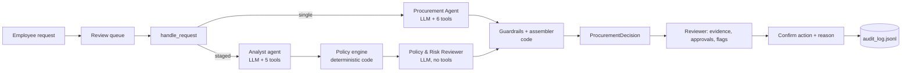
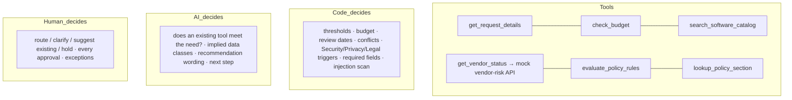
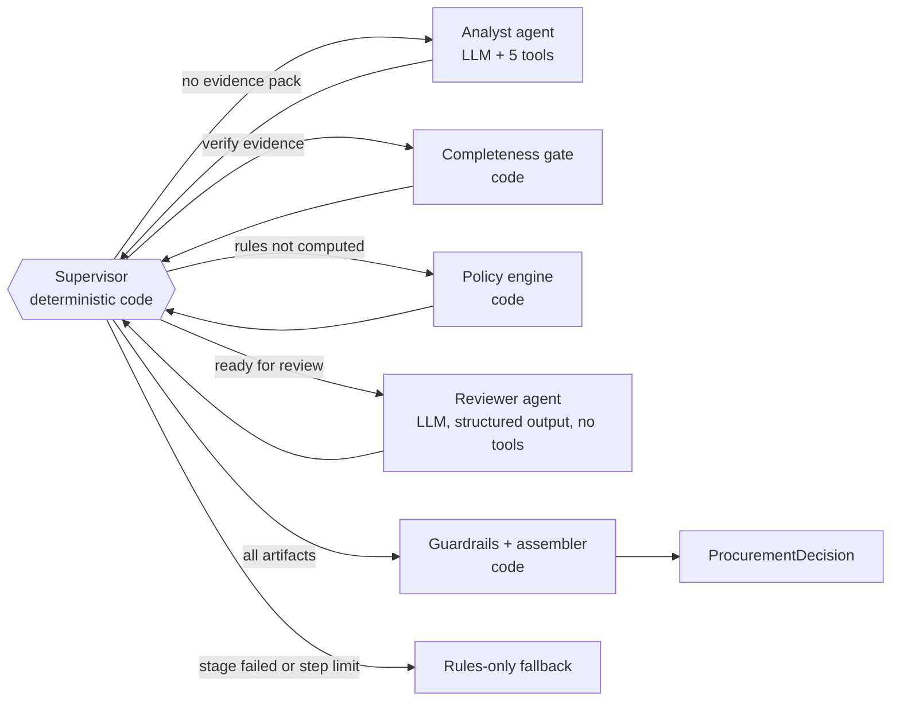

# Architecture: AI Procurement Request Copilot

Companion to `README.md`. Sections follow SPEC_V2_DELTA D15. Every number quoted here comes from `evals/results/` (primary eval) or, where named, `evals/results_qwen/` (second model).

## 1. Design ladder (Class 12)

The rule we followed: choose the least autonomous design that reliably meets the need, and let the evaluation decide whether each step up is worth its cost.

| Rung | In this product | Why it is or is not enough |
|---|---|---|
| Single LLM call | Not built | One opaque call: no tool evidence, no traceability, cannot enforce thresholds. |
| Chatbot | Not built | The reviewer needs one analysis per request; follow-ups go to people (requester, approvers), not to a chat. |
| Workflow | **Rules-only mode**: fixed steps, deterministic policy engine (R0–R12) | Predictable and testable, and it is the evaluation baseline. It cannot judge whether an existing tool meets the need (G-08) or see a data class implied only by free text (G-23). |
| Bounded agent | **Architecture A**: one agent, 6 scoped tools, step limit, completeness gate, guardrails | Adds dynamic evidence choice and the two judgements above, bounded by code. |
| Sequential specialists (Class 13) | **Architecture B**: Analyst → code → Reviewer, deterministic supervisor | Tests whether an independent review stage improves grounding and judgement enough to justify the extra calls. |

Code decides thresholds, budget, review currency, conflicts, the Security/Privacy/Legal triggers, required fields and the injection scan. The LLM may only add Security, Privacy or Legal with a reason, judge overlap and write the wording. Humans approve.

## 2. Diagrams





Architecture B's supervisor (deterministic code, not an LLM router):



## 3. Agent cards (D7)

| | A: Procurement Agent | B1: Procurement Analyst | B2: Policy & Risk Reviewer | Supervisor (B) |
|---|---|---|---|---|
| Goal | One grounded `AgentProposal` for one request | One `EvidencePack` for one request | One `ReviewerProposal`, every claim checked against raw tool results | Route the request through the stages, then stop |
| Instructions | `SYSTEM_SINGLE` | `SYSTEM_ANALYST` | `SYSTEM_REVIEWER` | Code (`supervisor()`), no LLM |
| Context | User message: request ID + reference date; tool results | Same | Evidence pack + raw tool results + policy-engine result + referenced policy sections | `StagedState` |
| Tools | 6 + `submit_recommendation` | 5 + `submit_evidence_pack` | None (structured output) | Runs gate, policy engine, guardrails |
| State | `RunContext` (messages, cache, tool log, evidence corpus, turn and repeat counters) | Same | Stateless single call | `StagedState` |
| Stop | submitted / `max_turns`=6 / `loop_detected` / `invalid_output` / `llm_unavailable` | Same, `max_turns`=5 | One call + one repair | All artifacts present / stage failed / `MAX_STAGED_STEPS`=8 |
| On failure | Finalizer, then rules-only fallback | Rules-only fallback | Fallback keeping stage-1 evidence that passes grounding | Fallback |

Code: `src/agents/single_agent.py`, `src/agents/staged_agent.py`, shared loop `src/agents/loop.py`, prompts `src/prompts.py`.

## 4. Tools

| Tool | Returns | Type | A | B1 Analyst | B2 Reviewer | Code (gate / orchestrator) |
|---|---|---|:-:|:-:|:-:|:-:|
| `get_request_details` | Normalised facts, requester, missing fields, injection scan; free text under `untrusted_text` | Deterministic | yes | yes | — | gate |
| `check_budget` | Available budget and whether the cost fits | Deterministic | yes | yes | — | gate |
| `search_software_catalog` | Overlapping catalog products, purchase history, overlap-flag candidates | Deterministic | yes | yes | — | gate |
| `get_vendor_status` | Registry + vendor-risk API, reconciled at the reference date (age, expiry, conflict, new vendor, terms, residency) | Deterministic logic over an **external** service | yes | yes | — | gate |
| `evaluate_policy_rules` | Approvals with reasons, flags, missing information, tier, data classes | Deterministic, **authoritative** | yes | — | receives result | orchestrator |
| `lookup_policy_section` | Exact text of one policy section | Deterministic | yes | yes | sections pre-attached | — |
| `submit_recommendation` | — (the agent's output) | Schema-validated | yes | — | via structured output | — |
| `submit_evidence_pack` | — (the analyst's output) | Schema-validated | — | yes | — | — |

No tool can approve, purchase, notify, edit a budget or accept terms. A call to a tool outside the caller's allowlist, or to an unknown name, is not executed: it returns `{"status": "error", "error": "tool not available to this agent"}` and is logged as `tool_rejected`. Tool descriptions (in `src/tools.py`) say what each returns, when to call it, whether it is deterministic or external, and what it does not do.

## 5. AI vs code vs human

| Decides | What |
|---|---|
| Code | Approval thresholds (R4), budget (R3), review currency and expiry (R6), registry/API conflicts (R6), Security/Privacy/Legal triggers (R6–R9), required fields (R1), injection scan (R10), final decision precedence (R12), grounding of evidence, output filter |
| AI | Whether a catalog product already meets the stated need (`overlap_assessment`), data classes implied only by free text (may add Security/Privacy/Legal with a reason), recommendation and next-step wording |
| Human | Which action to take (send for approvals, request clarification, suggest existing tool, hold), every approval and exception. Overrides need a written reason; every action goes to `runtime/audit_log.jsonl`. |

## 6. Handoff schema (B: Analyst → Reviewer)

The structured handoff is `EvidencePack` (`src/schemas.py`): `need_summary`, `data_classes_implied`, `overlap_assessment`, `vendor_observations`, `uncertainties`, `injection_observed`, `injection_excerpt`, `evidence`, `gaps`, `unsupported_or_unverified`. It is validated with pydantic (one repair, then fallback); prose is never passed between agents. The reviewer also receives the raw tool results, the policy-engine result and only the policy sections the engine cited, and returns a `ReviewerProposal` with an `analyst_audit` (issues found, rejected claims, agreement with the overlap assessment).

Real example (`evals/results_qwen/runs/staged/G-02_t1.json`, REQ-1002, provider Groq `qwen/qwen3.8-27b`), lightly trimmed:

```json
{
 "need_summary": "Marketing wants a design tool for fast campaign-template creation that non-designers can use, at 25 users and $12,000/yr.",
 "data_classes_implied": [
  "internal_marketing",
  "personal_data (vendor processes personal data per vendor-risk service)"
 ],
 "overlap_assessment": [
  {
   "software_id": "SW001",
   "relationship": "substitute_could_meet_need",
   "covers_stated_need": true,
   "reason": "PixelCraft Pro is an approved, company-wide design/prototyping license (65 seats) in the same category. The justification only says it is 'too specialist for non-designers' and names no specific missing capability (e.g., a template feature), so the stated gap is not credible on its face. A higher/Enterprise tier of an existing licensed product would also fall here. Human reviewer should confirm with the requester which capability is missing."
  },
  {
   "software_id": "SW002",
   "relationship": "substitute_could_meet_need",
   "covers_stated_need": true,
   "reason": "CreativeSuite is an approved Marketing-scoped creative production suite (40 seats) in the same category. The justification does not name a capability it lacks for campaign-template creation, so the stated gap is not credible on its face. Human reviewer should confirm with the requester."
  }
 ],
 "vendor_observations": [
  "BrandBoard is a NEW vendor (procurement status New, onboarding incomplete).",
  "Security review is Pending in the registry and not_completed in the vendor-risk API — no review date, so it is missing, not merely stale.",
  "Legal terms are Draft and not approved.",
  "Vendor-risk API rates risk as medium.",
  "Vendor processes personal data (true) but does not store data outside the region (false).",
  "No registry/API conflict detected; both agree the vendor is pending."
 ],
 "gaps": [
  "No security review exists for BrandBoard (registry Pending, API not_completed) — required before any approval.",
  "Legal terms are Draft, not approved, for a new vendor with $12,000 annual spend (≥$10,000 threshold).",
  "Justification does not name a specific missing capability in PixelCraft Pro or CreativeSuite beyond 'too specialist for non-designers'.",
  "No evidence of unused capacity in the two existing design licenses (65 + 40 seats).",
  "Data access level is internal_marketing, but vendor processes personal data — scope of PII access by BrandBoard is unspecified."
 ],
 "unsupported_or_unverified": [
  "Claim that PixelCraft is 'too specialist for non-designers' — no tool evidence either way.",
  "BrandBoard's suitability for campaign-template creation — no product evaluation on file.",
  "Vendor onboarding completion — registry and API both say incomplete, no completion date."
 ],
 "injection_observed": false,
 "evidence": [
  {
   "source": "get_request_details",
   "finding": "Requester Sarah Lee (E001, Marketing, IC4); product BrandBoard Enterprise, vendor BrandBoard, category Design & Creative; annual cost $12,000; 25 users; data access level internal_marketing; integration SSO; urgency normal; no missing fields.",
   "reference": "REQ-1002"
  },
  {
   "source": "check_budget",
   "finding": "Marketing annual budget $180,000; committed $165,000; available $15,000; request $12,000 is within budget, leaving $3,000.",
   "reference": "department_budgets.csv:Marketing"
  },
  {
   "...": "4 more items"
  }
 ]
}
```

Reviewer's `analyst_audit` for the same run:

```json
{
 "issues_found": [],
 "rejected_claims": [],
 "agrees_with_overlap_assessment": true
}
```

## 7. Stop and escalation conditions

- Every result has `human_review_required = true`; the copilot only recommends.
- Agent loops stop on submission, `max_turns`, `loop_detected` (two all-repeat turns), `invalid_output` (after one repair) or `tool_use_failed`; a failed loop goes to the structured finalizer, then to the rules-only fallback.
- B's supervisor stops on all artifacts present, a failed stage, or `MAX_STAGED_STEPS` = 8.
- LLM unavailable (outage, rate limit, auth): rules-only fallback with the flag `llm_unavailable` and the banner "AI analysis unavailable: showing rule-based result".
- Vendor-risk API unavailable: flag `vendor_risk_unavailable`, both evidence gaps listed, never a favorable status; Security unless the registry review is current and the data is not sensitive (Assumption 13).
- Every run's trace records ordered steps, `stop_reason` and `final_mode` (UI panel "How this was decided"; `evals/results/runs/`).

## 8. Failure mode → control → proof (T0.3)

| Failure mode | Control | Proof |
|---|---|---|
| Wrong tool / skipped evidence | Completeness gate runs any missing required tool | `test_failure_lab::test_skipped_tools_are_gate_filled`; metric `gate_filled` |
| Unsupported conclusion | Policy engine is authoritative; grounding check drops evidence whose numbers, dates or IDs are not in tool results | `test_guardrails` (EvidenceTests); metric `ungrounded_evidence_removed` |
| Loop | `MAX_TURNS`; repeated identical tool calls served from cache and counted; two all-repeat turns → forced finish | `test_failure_lab::test_loop_is_stopped`; `stop_reason=loop_detected` |
| Invalid output | Pydantic validation, one repair, then JSON-schema finalizer, then rules-only fallback | `test_failure_lab::test_invalid_output_repaired`, `::test_invalid_twice_falls_back` |
| Too much autonomy | No action tools; unknown tools rejected; output filter; `human_review_required = true` | `test_failure_lab::test_unknown_tool_rejected`; golden `safety_ok` |
| Unstructured handoff | `EvidencePack` validated; invalid pack → one repair → fallback | `test_staged::test_invalid_pack_falls_back` |
| Supervisor loop | Deterministic `supervisor()` with `MAX_STAGED_STEPS` | `test_staged::test_step_limit_stops` |
| Specialist disagreement | Reviewer records rejected analyst claims in `analyst_audit`; policy engine breaks ties; shown in UI | `test_staged::test_reviewer_audit_recorded`; metric `reviewer_rejections` |
| No escalation | Every result routes to a human; degraded states show banners; actions need confirmation | `test_solution_rules_only`; `test_webapp` |
| No trace | Trace with ordered steps and `stop_reason` saved for every run | `test_trace::test_trace_has_steps_and_stop_reason` |
| Prompt injection in business data | Regex scanner (R10), untrusted-data block, role and flag filtering | `test_injection`; golden G-06, G-16, G-17 |
| Tool / API unavailable | Classified vendor outcomes; never favorable; flags + banners | `test_vendor_tool`; golden G-09, G-21 |
| LLM unavailable or rate-limited | Rules-only fallback with `llm_unavailable`; eval separates `infra_error` from model failure | golden G-22; `test_llm_client` |

## 9. What we deliberately did not build

- An LLM-routed supervisor: routing is deterministic, so it stays in code (Class 13).
- A third agent.
- LangGraph or another framework: plain Python gives exact LLM and tool-call counts, fewer dependencies for the one-command start, and the graph is six deterministic nodes.
- RAG over the policy: the policy is short and structured; the engine encodes it and `lookup_policy_section` returns exact text.
- Real integrations (approvals, purchasing, email, Slack).

## 10. Prompt changes

Prompts are stored in `src/prompts.py` (T16 text plus the D13 additions). Changes from the spec text:

| Change | Why | Evidence |
|---|---|---|
| `SYSTEM_REVIEWER`: "You have no tools; call submit_recommendation exactly once." became "You have no tools; return your recommendation once, as the JSON object requested." | D2.7 makes the reviewer structured-output only; there is no tool to call. | Spec conflict (T16 vs D2.7), not an eval result. |
| `OUTPUT_RULES` (A, B reviewer, finalizer) and `SYSTEM_ANALYST` overlap line: added "If the existing product already does what the justification asks for and the request names no missing capability, a missing gap counts for the existing product: set covers_stated_need=true (...). It does not cover the need if the request needs a data class, integration or extra capacity the existing product is not approved or licensed for (§8)." | Both B agents read "no credible gap" backwards: they set `covers_stated_need=false` because the request did not explain why the licensed product was insufficient, so B routed a duplicate request for approval. The second sentence keeps add-ons, extra seats and new data classes from flipping the other way. Applied to both architectures. | Gemini 2.5 Flash, B, REQ-1008 (dev check, 10 Oct): analyst and reviewer `covers_stated_need=false`, reason "needs to clarify how it differs"; final `route_for_approval` vs golden `use_existing_tool`. |
| Same two places: the sentence above was replaced by "Two cases: (a) the request extends a product we already license (an add-on, module, pack, extra seats, identities or users, longer retention): that is an expansion, covers_stated_need=false; seat utilisation is unknown, so ask about unused capacity as a reviewer question instead of assuming it. (b) the request is a new product or tier for a need an existing product already serves, and the justification names no missing capability: (...) covers_stated_need=true (...). An existing product never covers a data class or integration it is not approved for (§8)." | The first wording fixed B's duplicate case but let A treat an add-on for extra signing identities as already covered ("sufficient capacity"), an assumption the data cannot support (no utilisation data, F §7). The spec already says more seats or an add-on is an expansion; this makes the two cases explicit. | Gemini 2.5 Flash, A, REQ-1001 (dev check, 10 Oct): `covers_stated_need=true`, "existing, approved SignFlow license (...) has sufficient capacity"; final `use_existing_tool` vs golden `route_for_approval`. Groq A showed the same on G-01. |
| Same two places: added "A higher tier or edition of a licensed product (for example a 'Pro' or 'Enterprise' version) belongs to (b) unless the justification names a capability the licensed version lacks." | qwen classed a higher tier of a company-wide licensed product as an expansion (case a) although the justification named no missing capability. | Groq `qwen/qwen3.8-27b`, A, REQ-1008 (dev check, 10 Oct): `same_product_expansion`, covers false, "base tier may or may not include the features"; final `route_for_approval` vs golden `use_existing_tool`. |

Prompts were frozen after these changes, before the first reported LLM eval run.

**Caveat.** These clarifications were tuned on development checks of public requests that are also golden cases (REQ-1008 = G-08, REQ-1001 = G-01), so those two cases may be optimistic for both architectures. In the reported eval, B's two extra failures (G-04, G-07) are both `use_existing_tool`: B's analyst and reviewer each set `covers_stated_need=true` for an existing product (a limited-use AI product for customer PII in G-04; the licensed base tier of the requested product in G-07), and code then applied R12. The reviewer's own `decision_type` was `route_for_specialist_review` in both. Case (b) of the overlap rule may be over-applied there; A judged the same two cases correctly. The prompts were not changed after the freeze.
